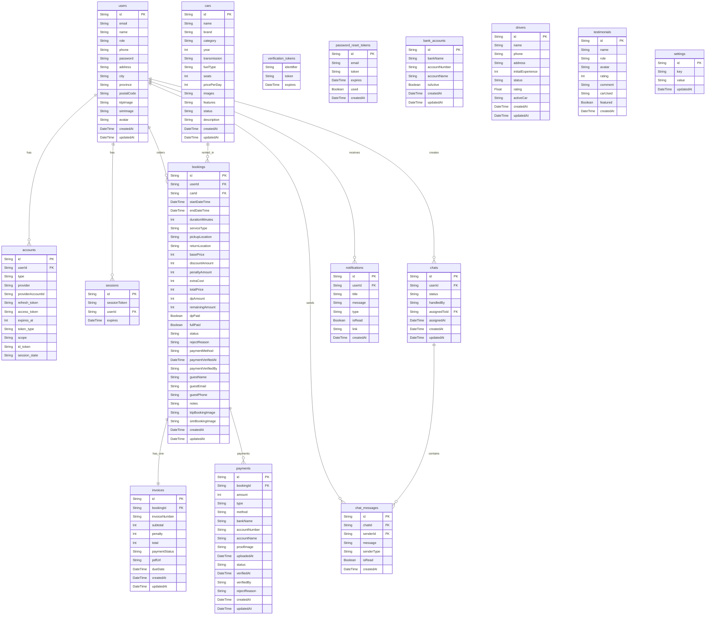

# Entity Relationship Diagram (ERD) - RentalMobil Jogja

Dokumentasi resmi struktur basis data dan relasi antar entitas untuk sistem informasi **RentalMobil Jogja**. Basis data menggunakan **PostgreSQL (Supabase)** dan dikelola menggunakan **Prisma ORM**.

---

## 1. Visualisasi Diagram Relasi (Mermaid ERD)

---

## 2. Kamus Data (Data Dictionary)

### A. Entitas Autentikasi & Pengguna

#### 1. `users` (Tabel: `users`)
Menyimpan kredensial pengguna, profil identitas, serta dokumen persyaratan rental.
- **`id`** (`String`, PK): Identifier unik cuid.
- **`email`** (`String`, Unique): Alamat surel unik pengguna.
- **`password`** (`String?`): Password terenkripsi dengan algoritma bcrypt.
- **`role`** (`String`): Hak akses (`USER` untuk pelanggan biasa, `ADMIN` untuk administrator).
- **`ktpImage`** (`String?`): Lokasi penyimpanan berkas identitas KTP.
- **`simImage`** (`String?`): Lokasi penyimpanan berkas SIM A (wajib untuk layanan lepas kunci).

#### 2. `accounts` & `sessions` (Tabel: `accounts`, `sessions`)
Dikelola oleh **NextAuth.js** untuk mendukung integrasi autentikasi OAuth (Google Login) dan token sesi aktif pengguna.

#### 3. `password_reset_tokens` & `verification_tokens`
Menyimpan token sementara dengan masa kedaluwarsa untuk kebutuhan reset sandi dan konfirmasi email.

---

### B. Entitas Inti Rental & Transaksi

#### 4. `cars` (Tabel: `cars`)
Master katalog armada kendaraan rental.
- **`id`** (`String`, PK): Identifier unit mobil.
- **`name`** (`String`): Nama komersial mobil (misal: "Toyota All New Avanza").
- **`category`** (`String`): Kategori klasifikasi (`SUV`, `MPV`, `Sedan`, `Hatchback`, `ELF`).
- **`transmission`** (`String`): Tipe transmisi (`Manual`, `Otomatis`).
- **`fuelType`** (`String`): Jenis bahan bakar (`Bensin`, `Solar`, `Listrik`).
- **`pricePerDay`** (`Int`): Tarif sewa harian (satuan Rupiah).
- **`images`** (`String`): Kumpulan URL gambar dalam representasi format JSON string.
- **`status`** (`String`): Status operasional mobil:
  - `AVAILABLE`: Siap dipesan.
  - `BOOKED`: Sedang aktif disewa.
  - `MAINTENANCE`: Sedang servis berkala / perbaikan bengkel.

#### 5. `bookings` (Tabel: `bookings`)
Mencatat transaksi reservasi rental baik oleh user terdaftar maupun pemesan tamu (Guest).
- **`userId`** (`String?`, FK): Merujuk ke `users.id` (bernilai `NULL` jika dipesan oleh guest).
- **`carId`** (`String`, FK): Merujuk ke `cars.id`.
- **`serviceType`** (`String`): Tipe layanan sewa (`LEPAS_KUNCI` atau `DENGAN_DRIVER`).
- **`status`** (`String`): Status alur reservasi:
  - `PENDING`: Menunggu inisiasi pembayaran.
  - `WAITING_DP`: Menunggu transfer & upload bukti DP 50%.
  - `DP_CONFIRMED`: DP telah diverifikasi, reservasi terkonfirmasi.
  - `IN_PROGRESS`: Mobil sedang dalam masa sewa (digunakan penyewa).
  - `WAITING_RETURN`: Masa sewa telah berakhir, unit menunggu dikembalikan ke garasi.
  - `WAITING_PAYMENT`: Mobil telah dikembalikan, menunggu pelunasan sisa biaya / denda.
  - `COMPLETED`: Seluruh pembayaran lunas dan unit telah selesai diperiksa.
  - `CANCELLED`: Dibatalkan oleh pelanggan.
  - `REJECTED` / `DENIED`: Ditolak oleh admin (misal dokumen tidak valid).

#### 6. `invoices` (Tabel: `invoices`)
Lembar tagihan resmi yang berhubungan satu-ke-satu (`1:1`) dengan reservasi booking.
- **`bookingId`** (`String`, FK, Unique): Terhubung secara unik ke 1 pemesanan.
- **`invoiceNumber`** (`String`, Unique): Nomor referensi resmi (format: `INV-YYYYMMDD-XXXX`).
- **`paymentStatus`** (`String`): Status pelunasan faktur (`UNPAID`, `PARTIAL`, `PAID`).
- **`pdfUrl`** (`String?`): Tautan unduh berkas digital PDF invoice.

#### 7. `payments` (Tabel: `payments`)
Mencatat setiap transaksi pembayaran (Down Payment 50%, Pelunasan Sisa, atau Denda).
- **`type`** (`String`): Jenis pembayaran (`DP`, `FULL_PAYMENT`, `PENALTY`).
- **`method`** (`String`): Metode transaksi (`QRIS`, `BCA_TRANSFER`, `BNI_TRANSFER`, `MANDIRI_TRANSFER`).
- **`proofImage`** (`String?`): Berkas upload tangkapan layar / foto struk transfer manual.
- **`status`** (`String`): Status approval bukti (`PENDING`, `VERIFIED`, `REJECTED`).

---

### C. Entitas Komunikasi & Penunjang Operasional

#### 8. `chats` & `chat_messages`
Mendukung interaksi pelanggan melalui live chat widget dengan arsitektur hybrid:
- **`handledBy`**: Bernilai `AI` (dijawab otomatis oleh bot AI) atau `ADMIN` (diambil alih staf admin).
- **`assignedToId`** (FK ke `users.id`): Menunjuk staf admin yang bertanggung jawab.

#### 9. `notifications` (Tabel: `notifications`)
Notifikasi linimasa internal pengguna terkait status booking, invoice, dan konfirmasi verifikasi DP.

#### 10. `drivers` (Tabel: `drivers`)
Daftar driver yang siap ditugaskan saat penyewa memilih opsi layanan `DENGAN_DRIVER`.
- **`status`**: `READY` (siap kerja), `ON_DUTY` (sedang bertugas), `INACTIVE` (cuti/libur).

#### 11. `bank_accounts`, `settings`, `testimonials`
- **`bank_accounts`**: Daftar rekening resmi rental untuk instruksi transfer manual pengguna.
- **`settings`**: Pasangan key-value untuk pengaturan dinamis (tarif driver per hari, kontak CS, durasi denda).
- **`testimonials`**: Manajemen feedback dan ulasan pelanggan untuk etalase halaman depan.

---

## 3. Matriks Relasi Antar Tabel

| Entitas Asal | Kardinalitas | Entitas Tujuan | Deskripsi Relasi | Aksi On Delete |
| :--- | :---: | :--- | :--- | :--- |
| `users` | 1 : N | `bookings` | Seorang pengguna dapat memiliki riwayat banyak booking | `SetNull` (menjaga riwayat transaksi) |
| `users` | 1 : N | `accounts` | Akun OAuth pihak ketiga terikat ke pengguna | `Cascade` |
| `users` | 1 : N | `sessions` | Sesi autentikasi aktif pengguna | `Cascade` |
| `users` | 1 : N | `chats` | Ruang percakapan bantuan yang dibuka pelanggan | `Cascade` |
| `users` (Admin) | 1 : N | `chats` | Penugasan admin untuk melayani chat pelanggan | `SetNull` |
| `users` | 1 : N | `chat_messages` | Pesan-pesan yang dikirim pengguna | `Cascade` |
| `users` | 1 : N | `notifications` | Notifikasi transaksi dan pembaruan akun | `Cascade` |
| `cars` | 1 : N | `bookings` | Satu armada mobil dapat disewa berulang kali | `Restrict` |
| `bookings` | 1 : 1 | `invoices` | Setiap pesanan memiliki tepat satu faktur invoice resmi | `Cascade` |
| `bookings` | 1 : N | `payments` | Setiap pesanan dapat memiliki pembayaran DP, pelunasan, & denda | `Cascade` |
| `chats` | 1 : N | `chat_messages` | Setiap sesi chat memuat riwayat pesan | `Cascade` |
