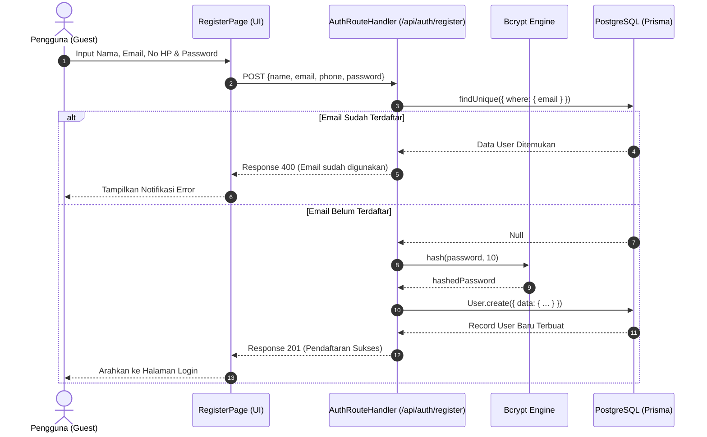
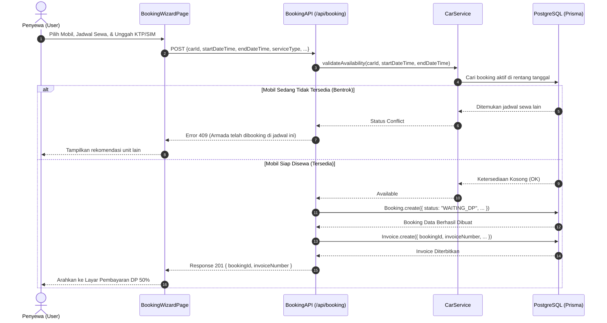
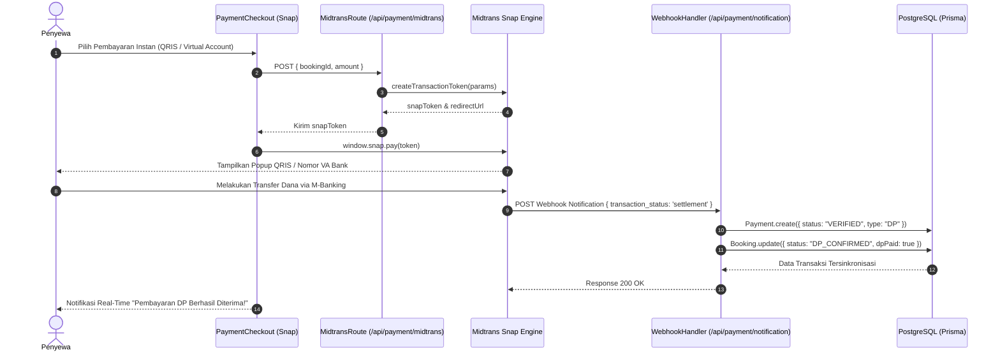
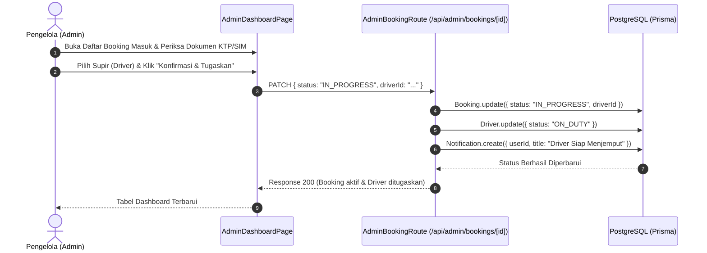
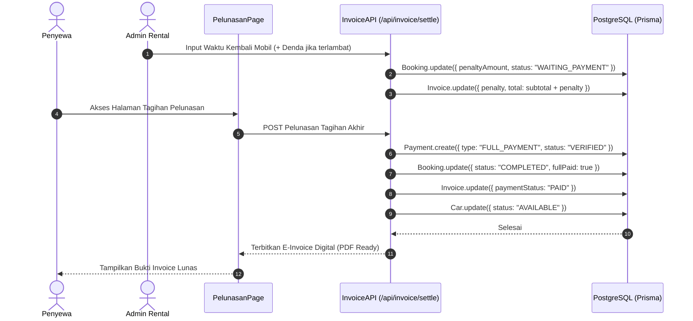

# Dokumen Perancangan Sistem & Basis Data
## Proyek: Sistem Informasi Rental Mobil Digital (RentalMobil Jogja)

Dokumen ini memuat spesifikasi arsitektur sistem, model logikal, normalisasi (1NF–3NF), model fisikal DBMS, serta sequence diagram antar kelas untuk diteruskan ke AI agent atau tim pengembang.

---

## I. Pilihan Arsitektur Sistem & Lingkungan Jaringan

### 1. Model Sistem: Terdistribusi (Distributed Multi-Tier Cloud Architecture)
Sistem ini menggunakan arsitektur terdistribusi multi-tier:
- **Presentation & Application Layer (Client-Server Web):** Dibangun dengan framework Next.js 14 (App Router), memisahkan rendering antarmuka sisi klien (*Client Components*) dan komputasi backend (*Server-Side Rendering & Route Handlers*).
- **Database Layer:** Terdistribusi secara mandiri pada infrastruktur **Supabase Cloud PostgreSQL** terdedikasi dengan *Connection Pooling* terpisah.
- **Third-Party Payment Gateway Layer:** Transaksi finansial didelegasikan ke **Midtrans Payment Gateway Engine** (Snap API & Webhook Notification) yang berjalan di server payment independen.
- **File Storage Layer:** Pengelolaan dokumen identitas fisik (KTP/SIM) dan bukti bayar melalui *File Storage Pipeline* terproteksi.

### 2. Lingkungan Jaringan: Internet (Public Web Application)
- **Aksesibilitas:** Berjalan pada jaringan **Internet publik** dengan protokol keamanan terenkripsi **HTTPS / TLS v1.3**.
- **Target Pengguna:** Dapat diakses multi-platform (Browser Desktop, Tablet, Smartphone) oleh pengguna umum/turis maupun tim operasional rental/admin secara *real-time*.

---

## II. Model Logikal (Logical Data Model & Normalisasi)

### 1. Skema Relasi Logikal (Relational Schema)
*Keterangan: Primary Key (**PK**) digarisbawahi, Foreign Key (*FK*) bertanda bintang.*

- **USERS** (<u>id</u>, name, email, password, phone, role, ktpImage, simImage, address, city, createdAt)
- **CARS** (<u>id</u>, name, brand, category, year, transmission, fuelType, seats, pricePerDay, status)
- **DRIVERS** (<u>id</u>, name, phone, address, initialExperience, status, rating)
- **BOOKINGS** (<u>id</u>, *userId*, *carId*, *driverId*, startDateTime, endDateTime, durationMinutes, serviceType, basePrice, penaltyAmount, extraCost, totalPrice, dpAmount, remainingAmount, status, paymentMethod)
- **INVOICES** (<u>id</u>, *bookingId*, invoiceNumber, subtotal, penalty, total, paymentStatus, dueDate)
- **PAYMENTS** (<u>id</u>, *bookingId*, amount, type, method, status, proofImage, uploadedAt, verifiedAt)
- **CHATS** (<u>id</u>, *userId*, *assignedToId*, status, handledBy, createdAt)
- **CHAT_MESSAGES** (<u>id</u>, *chatId*, *senderId*, message, senderType, isRead, createdAt)

---

### 2. Tahapan Normalisasi Basis Data

#### A. Bentuk Tidak Normal (Unnormalized Form / UNF)
Seluruh atribut pemesanan, kendaraan, supir, penagihan invoice, pembayaran, dan percakapan live chat berada dalam satu format data tidak terstruktur:
$$\text{RENTAL(id\_booking, tgl\_booking, nama\_user, email, ktp, mobil, merk, harga\_sewa, sopir, invoice, dp, bukti\_transfer, pesan\_chat)}$$
*Masalah:* Menyebabkan redundansi tinggi, anomali penyisipan (*insertion anomaly* saat mendaftarkan armada baru), dan anomali penghapusan (*deletion anomaly*).

#### B. Bentuk Normal Pertama (1NF - First Normal Form)
- **Syarat:** Setiap kolom bernilai atomik (tunggal), tidak terdapat atribut bernilai jamak (*multivalued*), dan setiap tabel memiliki *Primary Key*.
- **Penerapan:** Memisahkan berkas transaksi pembayaran (`PAYMENTS`) dari booking karena sebuah pemesanan dapat memiliki lebih dari satu transaksi pembayaran (DP, pelunasan sisa, dan denda). Pesan percakapan (`CHAT_MESSAGES`) juga dipisahkan menjadi baris atomik.

#### C. Bentuk Normal Kedua (2NF - Second Normal Form)
- **Syarat:** Memenuhi 1NF dan tidak memiliki ketergantungan parsial (*partial functional dependency*). Semua atribut non-kunci bergantung secara fungsional penuh pada Primary Key masing-masing entitas.
- **Penerapan:** 
  - Data master mobil dipisahkan ke tabel `CARS`.
  - Data supir dipisahkan ke tabel `DRIVERS`.
  - Data profil pelanggan dipisahkan ke tabel `USERS`.

#### D. Bentuk Normal Ketiga (3NF - Third Normal Form)
- **Syarat:** Memenuhi 2NF dan tidak memiliki ketergantungan transitif (*transitive functional dependency*), yaitu atribut non-kunci tidak boleh bergantung pada atribut non-kunci lainnya ($A \rightarrow B$, $B \rightarrow C$).
- **Penerapan:**
  - Perhitungan faktur tagihan dipisahkan ke tabel `INVOICES`.
  - Log verifikasi bukti transaksi dipisahkan ke tabel `PAYMENTS`.
  - Struktur basis data sistem telah **memenuhi standar 3NF** sehingga terbebas dari anomali pembaruan data (*update anomalies*).

---

## III. Model Fisikal (Physical Data Model / DBMS PostgreSQL)

Sistem menggunakan DBMS **PostgreSQL (Supabase)** yang dimodelkan melalui **Prisma ORM**.

### 1. Tabel: `users`
| Kolom | Tipe Data | Nullable | Key | Keterangan |
| :--- | :--- | :---: | :---: | :--- |
| `id` | `VARCHAR(30)` | NO | **PK** | ID unik (CUID) |
| `email` | `VARCHAR(191)` | NO | **UK** | Surel akun pengguna |
| `password` | `VARCHAR(255)` | YES | - | Hash sandi Bcrypt |
| `name` | `VARCHAR(100)` | YES | - | Nama lengkap pemesan |
| `phone` | `VARCHAR(20)` | YES | - | Nomor kontak WhatsApp |
| `role` | `VARCHAR(10)` | NO | - | `'USER'` / `'ADMIN'` |
| `ktpImage` | `TEXT` | YES | - | Path berkas identitas KTP |
| `simImage` | `TEXT` | YES | - | Path berkas SIM A |
| `createdAt` | `TIMESTAMP` | NO | - | Tanggal pendaftaran |

### 2. Tabel: `cars`
| Kolom | Tipe Data | Nullable | Key | Keterangan |
| :--- | :--- | :---: | :---: | :--- |
| `id` | `VARCHAR(30)` | NO | **PK** | ID unit mobil |
| `name` | `VARCHAR(100)` | NO | - | Model/tipe kendaraan |
| `brand` | `VARCHAR(50)` | NO | - | Pabrikan (Toyota, Honda, dll.) |
| `category` | `VARCHAR(30)` | NO | - | SUV, MPV, Sedan, City Car |
| `year` | `INT4` | NO | - | Tahun perakitan |
| `transmission` | `VARCHAR(20)` | NO | - | `'Manual'` / `'Otomatis'` |
| `seats` | `INT4` | NO | - | Kapasitas penumpang |
| `pricePerDay` | `INT4` | NO | - | Tarif sewa per hari (IDR) |
| `status` | `VARCHAR(20)` | NO | - | `'AVAILABLE'`, `'BOOKED'`, `'MAINTENANCE'` |

### 3. Tabel: `drivers`
| Kolom | Tipe Data | Nullable | Key | Keterangan |
| :--- | :--- | :---: | :---: | :--- |
| `id` | `VARCHAR(30)` | NO | **PK** | ID unik pengemudi |
| `name` | `VARCHAR(100)` | NO | - | Nama lengkap supir |
| `phone` | `VARCHAR(20)` | NO | - | Nomor kontak aktif supir |
| `initialExperience`| `INT4` | NO | - | Pengalaman kerja (tahun) |
| `status` | `VARCHAR(20)` | NO | - | `'READY'`, `'ON_DUTY'`, `'INACTIVE'` |
| `rating` | `FLOAT8` | NO | - | Rata-rata bintang ulasan |

### 4. Tabel: `bookings`
| Kolom | Tipe Data | Nullable | Key | Keterangan |
| :--- | :--- | :---: | :---: | :--- |
| `id` | `VARCHAR(30)` | NO | **PK** | Nomor reservasi rental |
| `userId` | `VARCHAR(30)` | YES | **FK** | Referensi ke `users.id` |
| `carId` | `VARCHAR(30)` | NO | **FK** | Referensi ke `cars.id` |
| `startDateTime` | `TIMESTAMP` | NO | - | Jadwal mulai penggunaan |
| `endDateTime` | `TIMESTAMP` | NO | - | Jadwal batas pengembalian |
| `durationMinutes`| `INT4` | NO | - | Total durasi pemakaian (menit) |
| `serviceType` | `VARCHAR(30)` | NO | - | `'LEPAS_KUNCI'` / `'DENGAN_DRIVER'` |
| `totalPrice` | `INT4` | NO | - | Total tagihan kotor sewa |
| `dpAmount` | `INT4` | NO | - | Besaran DP 50% |
| `remainingAmount`| `INT4` | NO | - | Sisa tagihan pelunasan |
| `status` | `VARCHAR(30)` | NO | - | Status transaksi booking |
| `paymentMethod` | `VARCHAR(30)` | YES | - | Opsi bayar yang dipilih |

### 5. Tabel: `invoices`
| Kolom | Tipe Data | Nullable | Key | Keterangan |
| :--- | :--- | :---: | :---: | :--- |
| `id` | `VARCHAR(30)` | NO | **PK** | ID unik invoice |
| `bookingId` | `VARCHAR(30)` | NO | **FK, UK** | Relasi 1:1 ke `bookings.id` |
| `invoiceNumber` | `VARCHAR(50)` | NO | **UK** | Format: `INV-YYYYMMDD-XXXX` |
| `subtotal` | `INT4` | NO | - | Biaya sewa pokok |
| `penalty` | `INT4` | NO | - | Denda over-time jika ada |
| `total` | `INT4` | NO | - | Subtotal + denda |
| `paymentStatus` | `VARCHAR(20)` | NO | - | `'UNPAID'`, `'PARTIAL'`, `'PAID'` |
| `dueDate` | `TIMESTAMP` | NO | - | Batas waktu pelunasan |

### 6. Tabel: `payments`
| Kolom | Tipe Data | Nullable | Key | Keterangan |
| :--- | :--- | :---: | :---: | :--- |
| `id` | `VARCHAR(30)` | NO | **PK** | ID transaksi pembayaran |
| `bookingId` | `VARCHAR(30)` | NO | **FK** | Referensi ke `bookings.id` |
| `amount` | `INT4` | NO | - | Nominal uang disetor |
| `type` | `VARCHAR(20)` | NO | - | `'DP'`, `'FULL_PAYMENT'`, `'PENALTY'` |
| `method` | `VARCHAR(30)` | NO | - | Saluran transfer / Midtrans |
| `proofImage` | `TEXT` | YES | - | File foto struk (transfer manual) |
| `status` | `VARCHAR(20)` | NO | - | `'PENDING'`, `'VERIFIED'`, `'REJECTED'` |

---

## IV. Model Interaksi Antar Kelas (Sequence Diagram per Use Case)

### Use Case 1: Registrasi Akun Pengguna (Registration)

---

### Use Case 2: Reservasi Mobil & Verifikasi Ketersediaan (Booking)

---

### Use Case 3: Pembayaran DP via Midtrans Gateway & Webhook

---

### Use Case 4: Verifikasi & Penugasan Driver oleh Admin

---

### Use Case 5: Pengembalian Unit, Pelunasan Sisa Tagihan & E-Invoice

